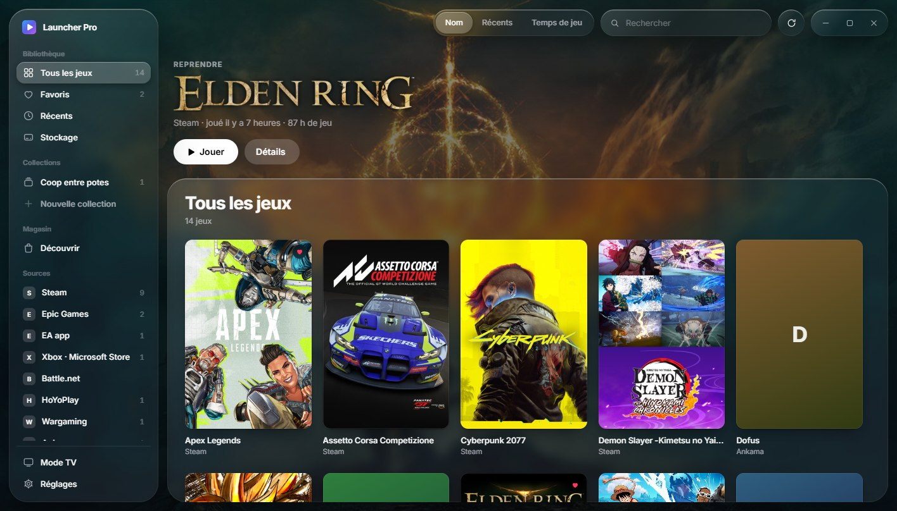
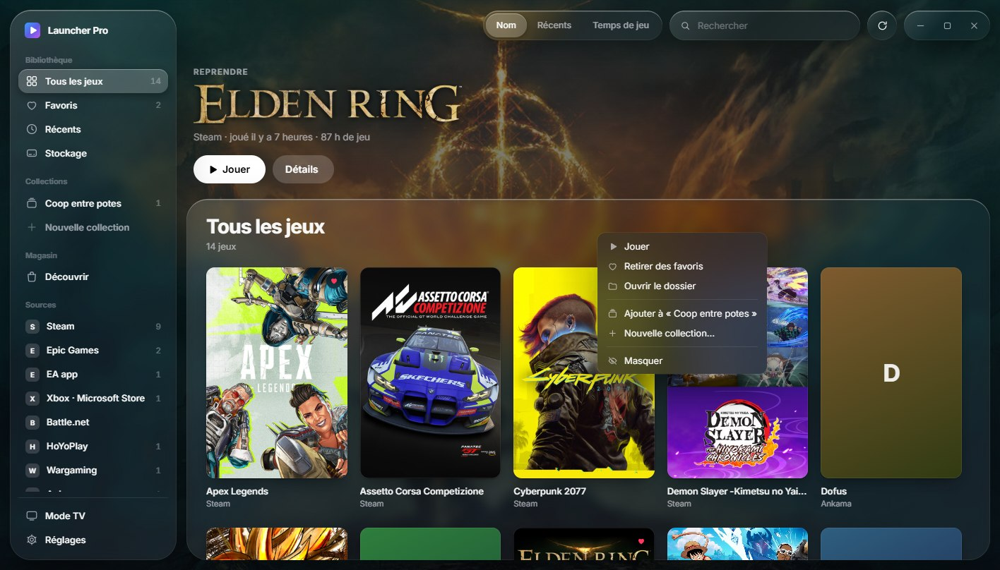
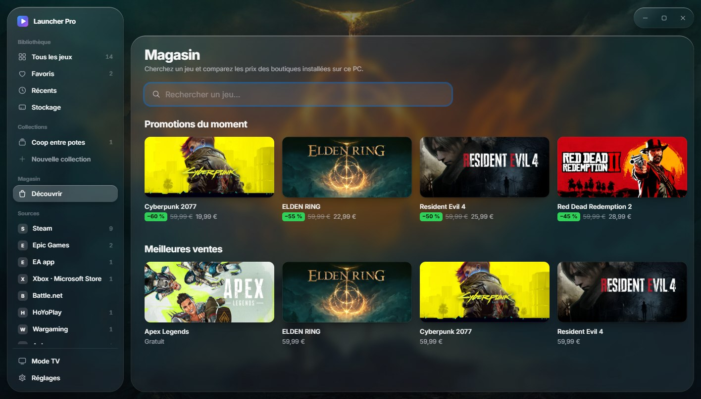
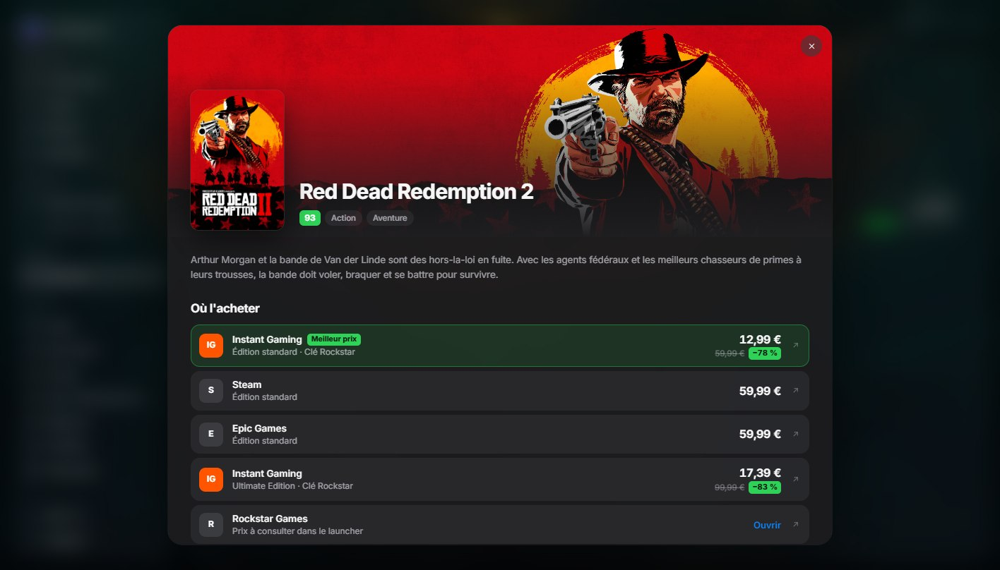
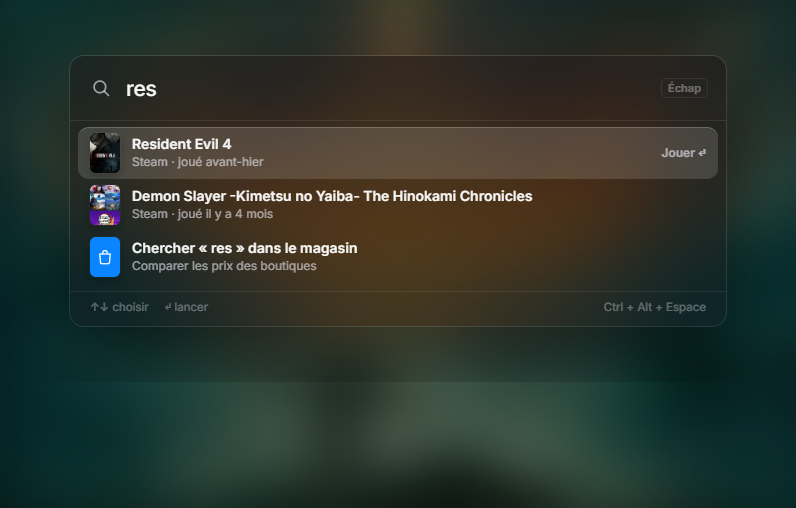
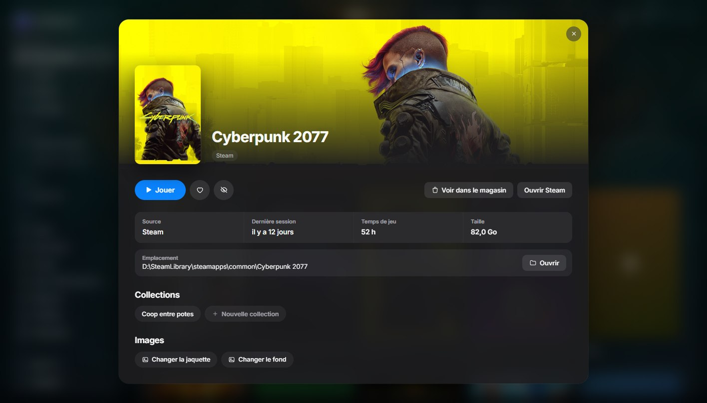
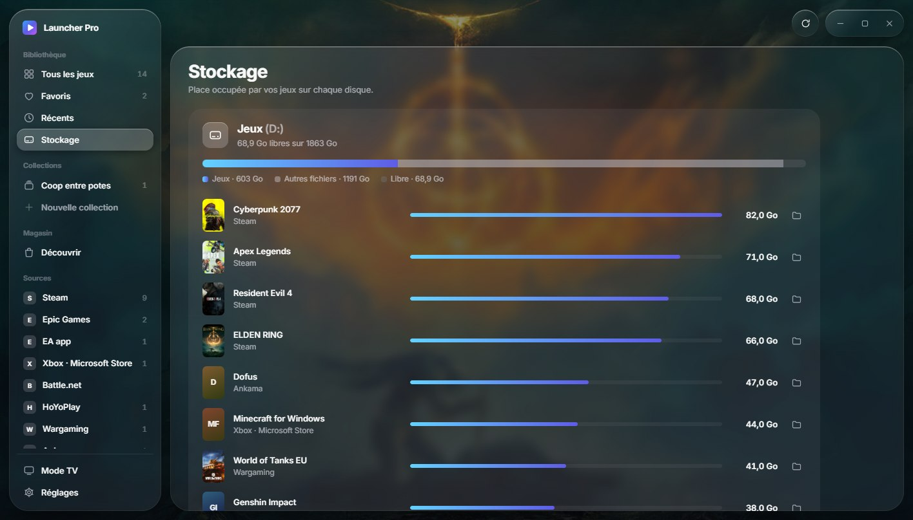
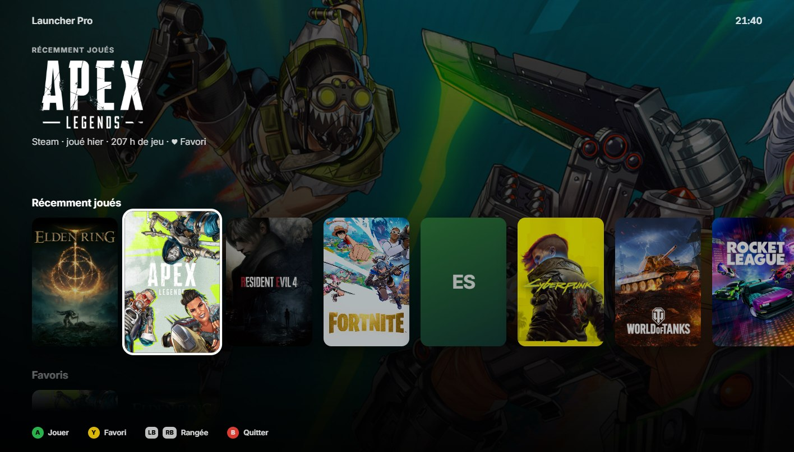
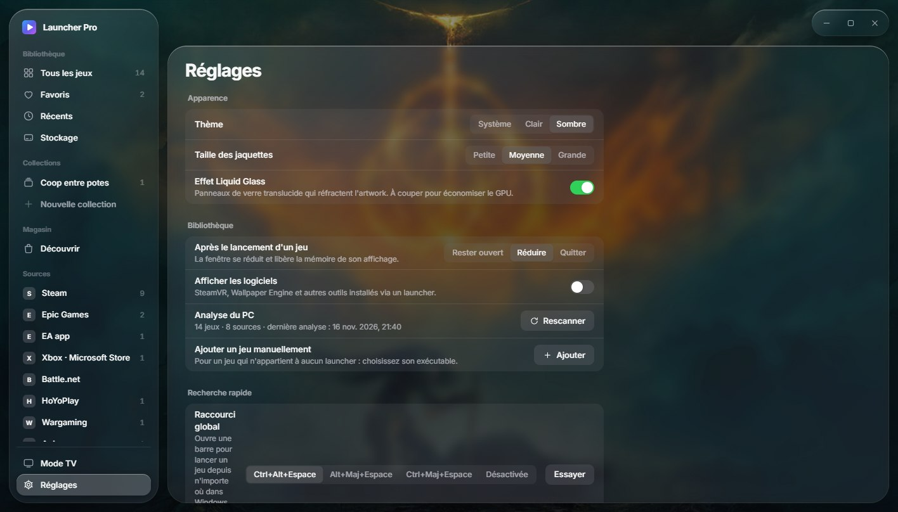
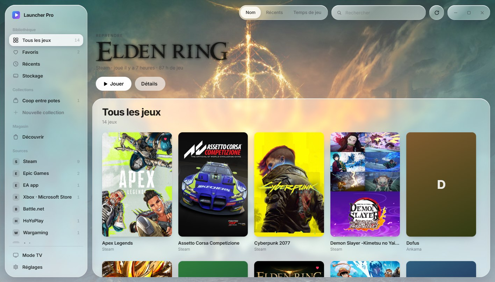

<div align="center">


# Launcher Pro

**Tous vos jeux PC, tous vos launchers, une seule bibliothèque.**
Steam, Epic, EA, Xbox, HoYoPlay, Battle.net et bien d'autres, détectés tout seuls, dans une interface en verre liquide inspirée d'Apple.


</div>



Launcher Pro rassemble en un seul endroit tous les jeux installés sur votre PC, quel que soit le launcher qui les a installés. Pas de compte à relier, pas de dossier à indiquer : vous l'ouvrez, tout est déjà là. Un clic sur **Jouer** lance le jeu par son launcher d'origine, et l'onglet **Magasin** compare les prix d'un jeu entre les boutiques présentes sur votre PC et Instant Gaming.

L'application est écrite en Rust (Tauri 2) avec une interface React affichée par le moteur web intégré à Windows : un exécutable d'environ 11 Mo, sans Chromium embarqué.

---

## Sommaire

- [Fonctionnalités](#fonctionnalités)
- [Launchers pris en charge](#launchers-pris-en-charge)
- [Performances](#performances)
- [Confidentialité](#confidentialité)
- [Compiler et lancer](#compiler-et-lancer)
- [Développement](#développement)
- [Architecture](#architecture)
- [Limites connues](#limites-connues)
- [Feuille de route](#feuille-de-route)

---

## Fonctionnalités

### Une bibliothèque unifiée, détectée toute seule

- **Détection automatique** de 14 sources : launchers, Microsoft Store, jeux autonomes (Unity, Unreal, Godot…) et ajout manuel. L'analyse complète prend environ 150 ms.
- **Jaquettes et fonds** : le cache local des launchers d'abord ; à défaut, téléchargement depuis les boutiques ; en dernier recours, l'icône du jeu sur un dégradé.
- **Un fond vivant** : l'arrière-plan prend l'artwork du jeu que vous survolez, et la bannière « Reprendre » met en avant le dernier jeu lancé.
- **Tri** par nom, date ou temps de jeu, **recherche** instantanée (Ctrl+F), **favoris**, **récents**, et vue par launcher.
- **Clic droit** sur une jaquette : jouer, favori, ouvrir le dossier, ranger dans une collection, masquer.
- **Après le lancement d'un jeu**, Launcher Pro peut rester ouvert, se réduire (il libère alors la mémoire de son affichage) ou se fermer complètement.



### Magasin et comparateur de prix

Cherchez n'importe quel jeu : Launcher Pro interroge **Steam, le Microsoft Store, GOG et Instant Gaming** et regroupe les résultats par jeu. Les éditions (Deluxe, Ultimate…) sont rattachées au jeu de base, et la meilleure offre est mise en avant.

La fiche d'un jeu affiche sa description, ses captures, sa note Metacritic, son éditeur et sa configuration minimale. Si vous possédez déjà le jeu, un bouton **Jouer** apparaît directement dans le magasin.

Par défaut, seules les boutiques dont le launcher est installé sont comparées, plus Instant Gaming ; un réglage permet de les inclure toutes. Epic Games, EA, Ubisoft, Battle.net et Rockstar ne publient pas leurs prix : leur fiche propose un lien direct vers la boutique ou le launcher.

<p align="center">
  
  
</p>

### Recherche rapide, depuis n'importe où dans Windows

Un raccourci global ouvre une petite barre en verre au-dessus de tout, même quand Launcher Pro est réduit. Tapez quelques lettres (« eld », ou des initiales comme « rdr »), puis **Entrée** : le jeu se lance et la barre disparaît. La dernière ligne envoie la recherche vers le magasin.

Le raccourci par défaut est **Ctrl+Alt+Espace**. Si une autre application l'utilise déjà, Launcher Pro se rabat tout seul sur **Alt+Maj+Espace**, et les réglages indiquent celui qui est réellement actif.

<p align="center">
  
</p>

### Fiches de jeu, collections et jaquettes personnalisées

- **Collections** : regroupez vos jeux comme des playlists (« Coop entre potes », « À finir »…), depuis la barre latérale, le clic droit ou la fiche du jeu.
- **Jaquettes personnalisées** : remplacez la jaquette ou le fond d'un jeu par l'image de votre choix (JPEG, PNG, WebP, AVIF), puis rétablissez l'original en un clic.
- **Fiche détaillée** : temps de jeu, dernière session, taille, emplacement et bouton « Ouvrir le dossier ».



### Stockage

Pour chaque disque, une barre montre l'espace pris par les jeux, par les autres fichiers et l'espace libre, puis la liste des jeux du plus gros au plus petit. Quand un launcher ne donne pas la taille de ses jeux (HoYoPlay, Wargaming, Xbox…), Launcher Pro mesure lui-même leur dossier.



### Mode TV, à la manette

Un mode plein écran pour jouer depuis le canapé : grandes jaquettes en rangées (récents, favoris, collections, tous les jeux) et fond qui suit le jeu sélectionné. Il s'ouvre avec le bouton **Start** de la manette ou depuis la barre latérale.

- Ⓐ jouer, Ⓨ favori, Ⓑ quitter
- LB / RB pour changer de rangée
- Au clavier : flèches, Entrée, Échap



### Jeux masqués, protégés par mot de passe

Un jeu masqué disparaît de toute l'application : listes, compteurs, recherche et magasin. Le mot de passe saisi dans les réglages fait réapparaître l'onglet **Masqués**, jusqu'au verrouillage ou à la fermeture de l'application.

Seule une empreinte **Argon2id** du mot de passe est enregistrée, jamais le mot de passe lui-même. Il s'agit d'une protection de l'interface, pas d'un chiffrement : les jeux restent visibles dans leur launcher d'origine. En cas d'oubli, supprimez la ligne `hiddenPassword` du fichier `%APPDATA%\fr.launcherpro.desktop\prefs.json`.

### Un style « Liquid Glass »

Panneaux translucides qui réfractent l'artwork sur leurs bords, thèmes clair, sombre ou système, trois tailles de jaquettes. L'effet de verre peut être coupé pour économiser le processeur graphique.

<p align="center">
  
  
</p>

---

## Launchers pris en charge

| Source | Ce qui est lu | Lancement | État |
| --- | --- | --- | --- |
| **Steam** | `libraryfolders.vdf`, manifestes, temps de jeu, jaquettes du cache local | `steam://rungameid/…` | ✅ Testé |
| **Epic Games** | Manifestes `.item`, catalogue local (jaquettes) | `com.epicgames.launcher://…` | ✅ Testé |
| **EA app** | Registre, `installerdata.xml` | Exécutable du jeu | ✅ Testé |
| **Xbox / Microsoft Store** | Gaming Services (registre), manifestes des paquets | `shell:AppsFolder\…` | ✅ Testé |
| **HoYoPlay** (Genshin Impact, Honkai: Star Rail, ZZZ) | Registre | `launcher.exe --game=…` | ✅ Testé |
| **Wargaming** (World of Tanks…) et Lesta | Game Center, `game_info.xml` | `wgc_api.exe --open` | ✅ Testé |
| **Kuro Games** (Wuthering Waves) | Registre, dossiers du jeu | Launcher | ✅ Testé |
| **Ankama** (Dofus, Wakfu…) | Dépôts du launcher Ankama | Launcher | ✅ Testé |
| **Ajout manuel** | Exécutable choisi | Exécutable | ✅ Testé |
| **Battle.net** | `product.db` | `Battle.net.exe --exec="launch …"` | ⚠️ Launcher détecté, aucun jeu installé pour tester |
| **Rockstar Games** | Registre | Launcher Rockstar | ⚠️ Launcher détecté, aucun jeu installé pour tester |
| **GRYPHLINK** (Arknights: Endfield) | Dossier `games` du launcher | Launcher | ⚠️ Launcher détecté, aucun jeu installé pour tester |
| **Ubisoft Connect** | Registre | `uplay://launch/…` | ❔ Écrit, pas encore testé |
| **GOG Galaxy** | Registre (jeux GOG avec ou sans Galaxy) | Exécutable ou Galaxy | ❔ Écrit, pas encore testé |
| **Riot Games** | `RiotClientInstalls.json`, métadonnées | Riot Client | ❔ Écrit, pas encore testé |
| **Jeux autonomes** | Programmes installés contenant un moteur de jeu (Unity, Unreal, Godot, Ren'Py, GameMaker…) | Exécutable | ❔ Écrit, pas encore testé |

Les retours sur les sources marquées ⚠️ ou ❔ sont les bienvenus.

---

## Performances

Mesures faites sur la machine de développement (Windows 11, environ 30 jeux et 11 launchers) :

| | |
| --- | --- |
| Taille de l'exécutable | ~11 Mo |
| Détection complète des jeux | ~150 ms |
| Processeur au repos | 0 % |
| Mémoire, fenêtre ouverte | ~460 Mo au total, dont la plus grande partie pour le moteur web WebView2 de Windows |
| Mémoire, fenêtre réduite | Le moteur de rendu passe d'environ 110 Mo à environ 10 Mo |
| Recherche rapide | Créée à la première utilisation, libérée après 10 minutes sans servir |

Pour ne plus rien consommer pendant une partie, choisissez **Réglages › Après le lancement d'un jeu › Quitter**.

---

## Confidentialité

- **Tout est local.** La détection lit uniquement le registre et les fichiers des launchers sur votre PC. Aucun compte n'est demandé et aucune télémétrie n'est envoyée.
- **Requêtes réseau** : uniquement les recherches du magasin (Steam, Microsoft Store, GOG, Instant Gaming) et le téléchargement des jaquettes manquantes. Launcher Pro s'y présente honnêtement (`LauncherPro/<version>`).
- **Vos données** (bibliothèque, favoris, collections, réglages) restent dans `%APPDATA%\fr.launcherpro.desktop` ; le cache d'images est dans `%LOCALAPPDATA%\fr.launcherpro.desktop`.

---

## Compiler et lancer

Aucun installeur n'est encore publié : Launcher Pro se compile depuis les sources.

**Prérequis**

- Windows 10 ou 11 avec le **runtime WebView2** (déjà présent sur Windows 11)
- [Rust](https://rustup.rs/) stable (chaîne MSVC)
- [Node.js](https://nodejs.org/) 20 ou plus récent
- **Visual Studio Build Tools** avec la charge de travail « Développement Desktop en C++ »

**Compilation**

```bash
git clone https://github.com/Corentin-vidonne/launcher-pro.git
cd launcher-pro
npm install
```

```bash
# Lancer en mode développement (rechargement à chaud de l'interface)
npm run tauri dev
```

```bash
# Exécutable optimisé : src-tauri/target/release/launcher-pro.exe
npx tauri build --no-bundle
```

`npx tauri build` (sans `--no-bundle`) produit en plus un installeur NSIS. Cette étape n'a pas encore été testée.

---

## Développement

- **Aperçu dans le navigateur** : `npm run dev`, puis ouvrir `http://localhost:1420`. Sans le backend Rust, l'interface utilise une bibliothèque de démonstration ([`src/lib/mock.ts`](src/lib/mock.ts)) ; c'est elle qui apparaît sur les captures de ce README.
- **Tests** : `cd src-tauri && cargo test`
- **Tests sur la vraie machine** (ignorés par défaut) :
  - `cargo test dump_scan -- --ignored --nocapture` affiche tout ce que la détection trouve sur le PC ;
  - `cargo test live_search -- --ignored --nocapture` interroge réellement les boutiques.
- **Diagnostic de la recherche rapide** : lancer l'application avec la variable d'environnement `LAUNCHERPRO_DEBUG=1` écrit un journal dans `%APPDATA%\fr.launcherpro.desktop\quick.log`.

---

## Architecture

```
src-tauri/src/
├── library/          Détection : un module par source (steam.rs, epic.rs, ea.rs, xbox.rs, hoyoplay.rs…)
├── store/            Magasin : steam.rs, microsoft.rs, gog.rs, instant_gaming.rs, regroupement des offres
├── art.rs            Jaquettes : cache disque, téléchargement, protocole art:// servi à l'interface
├── quick.rs          Recherche rapide : raccourci global et fenêtre acrylique
├── storage.rs        Vue Stockage : espace des disques, taille des dossiers
├── vault.rs          Mot de passe des jeux masqués (Argon2id)
├── shell.rs          Lancement des jeux (ShellExecute), extraction des icônes
├── state.rs          État partagé, persistance
└── commands.rs       Commandes appelées par l'interface

src/
├── components/       Écrans React : bibliothèque, magasin, stockage, mode TV, réglages…
├── quick/            Page légère de la recherche rapide (chargée seulement à l'usage)
└── lib/              API, types, effet de verre (lens.ts), données de démonstration

design/               Maquettes des trois directions visuelles explorées
```

**Technologies** : [Tauri 2](https://tauri.app/), Rust, React 19, TypeScript, Vite. Côté Rust : `reqwest` (TLS natif de Windows), `windows-rs`, `winreg`, `argon2`, `tauri-plugin-global-shortcut`.

---

## Limites connues

- **Windows uniquement.**
- **Prix** : pas de prix automatiques pour Epic Games, EA, Ubisoft, Battle.net et Rockstar, qui ne les publient pas (la boutique Epic bloque les requêtes qui ne viennent pas d'un navigateur).
- **Temps de jeu** : seul Steam le fournit pour l'instant.
- **Mode TV** : pas encore testé avec une vraie manette.
- **Installeur** : pas encore d'installeur testé ni de mise à jour automatique.

---

## Feuille de route

- [ ] Installeur, démarrage avec Windows et icône dans la zone de notification
- [ ] Temps de jeu suivi pour tous les launchers
- [ ] Liste de souhaits et alertes de baisse de prix
- [ ] Prix Epic, EA et Ubisoft via IsThereAnyDeal

---

## Avertissement

Launcher Pro est un projet indépendant, sans lien avec Valve, Epic Games, Electronic Arts, Microsoft, Ubisoft, Blizzard, Rockstar Games, HoYoverse, Wargaming, Kuro Games, Hypergryph, Ankama, Riot Games, GOG ou Instant Gaming. Les noms de jeux, logos et jaquettes appartiennent à leurs propriétaires respectifs.

Les captures de ce README utilisent la bibliothèque de démonstration et les visuels publics des boutiques.
